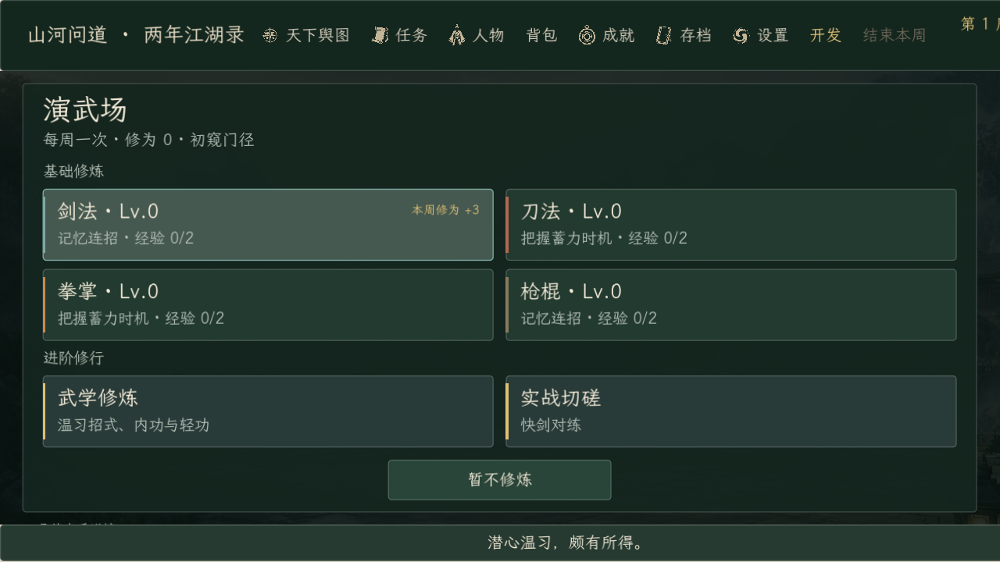
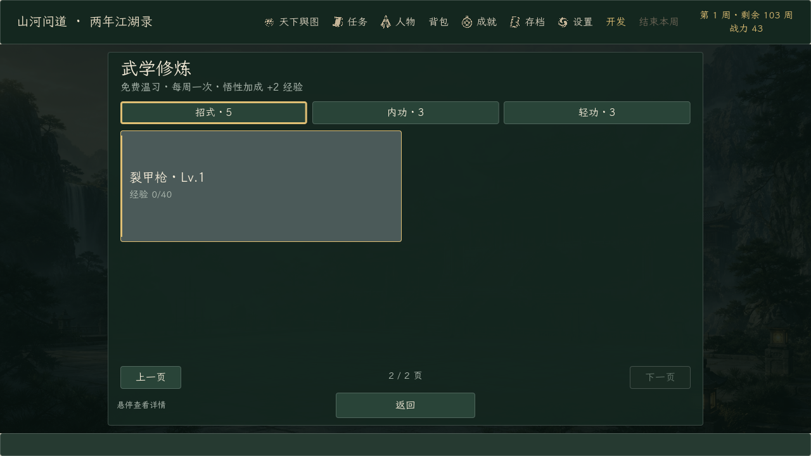
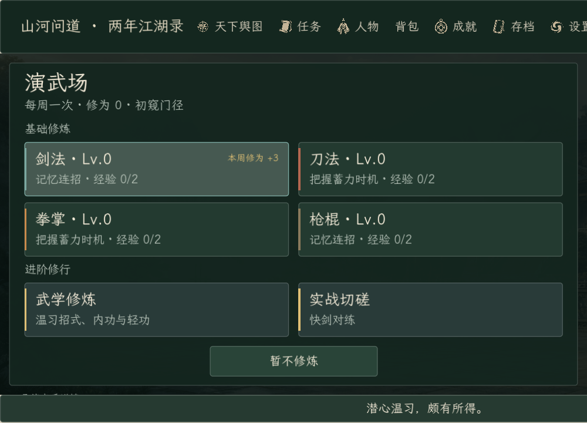

# 《山河问道》完整版 0.172.0 · 演武场紧凑选择界面验收

日期：2026-10-18。起点提交：`68af401`（0.171.0）。

演武场不再使用需要滚动的长列表：

- 剑法、刀法、拳掌、枪棍四项基础修炼与武学修炼、实战切磋分组为紧凑卡片；按钮位置固定，面板和返回按钮始终可见。
- 每张卡片保留等级、经验或本周修为加成；详细机制、大成状态与本周已行动状态移到 tooltip 和角标。
- 武学修炼按招式、内功、轻功分类，每页 4 项；练习后保留分类与页码，并立即反映已消耗的本周行动。没有已学武学时不伪造条目，始终保留可用返回。
- 实战切磋沿用同一套固定布局，以剑/以刀选择后返回演武场。
- 训练规则、评分、奖励与每周成本未改动。主菜单、制作名单和 Windows Desktop 预设版本同步为 0.172.0 / 0.172.0.0。

| 验证 | 结果 | 内容 |
| --- | ---: | --- |
| 隔离导入 | 1 / 1 | 独立工程名、隔离 APPDATA/LOCALAPPDATA，零诊断错误 |
| 基线回归 | 25 / 25 | 任务、存档、完整旅程、门派建设、战斗退出、人物与训练键盘输入等；`test_save_manager` 的 3 条损坏存档诊断按预期保留 |
| 定向回归 | 13 / 13 | 训练菜单、选择布局、键盘输入、小游戏规则、修炼事件、切磋、自由探索等；布局测试 1991 项检查、0 失败 |
| 实际渲染 | 2 / 2 | 100%/115%/130% 与 1000×720、1280×600；含截图时布局检查 2028 项、38 张截图 |
| 正式导出 | 2 / 2 | 导入 + Windows Desktop 完整版导出，零诊断错误 |
| 正式 EXE | 5 / 5 | 完整版标记、制作名单、Steam 数据、训练流程、暂停流程 |
| 正式 PCK | 2 / 2 | 真实包布局检查 1991 项、含截图 2028 项，均 0 失败 |

基线回归与定向回归有 6 项重叠，合计覆盖 32 个不同测试脚本、38 次执行，全部通过。详细逐项结果和源码哈希见 [verification-summary.json](verification-summary.json)。

初次验收的测试和截图发生在最后一处源码修改之前（当时文件哈希为 `BBA407…`）。本次将最终源码同步到隔离工程后，重新执行导入、基线、定向、渲染、导出、正式 EXE 和 PCK 检查；以上结果和截图均以最终哈希 `6D22B8…` 为准。所有会写存档的验收使用隔离 APPDATA 与 LOCALAPPDATA，正式包使用单独数据目录；输入均由自动化完成，未声称真人完整试玩。

截图由编辑器控制台宿主加载最终 PCK 运行，因此顶部显示开发入口；正式 EXE 的完整版检查已通过，发布包中的该入口在非调试构建下隐藏。130% 缩放和 1000×720 下顶部全局状态仍会被裁切，这是 0.171.0 已记录的问题，本次未重做顶部导航；演武场面板、分页和固定返回按钮均完整位于可见区域。

正式包为 Windows Desktop，EXE 109,268,480 字节，SHA-256 `34246D…C05`；PCK 59,356,936 字节，SHA-256 `C615F7…EEB8`。大小、版本和完整哈希见 [artifact-manifest.json](artifact-manifest.json)。Demo 预设仍为 0.122.0.0，Demo EXE 和 PCK 的 SHA-256 与改动前一致；本次只导出并验证完整版。
