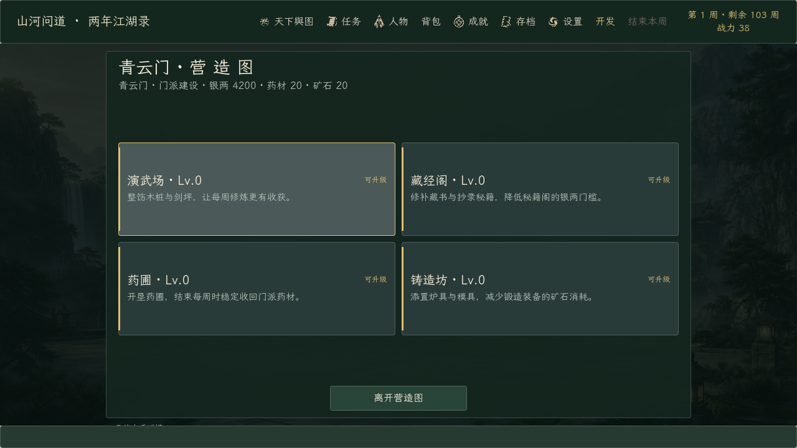
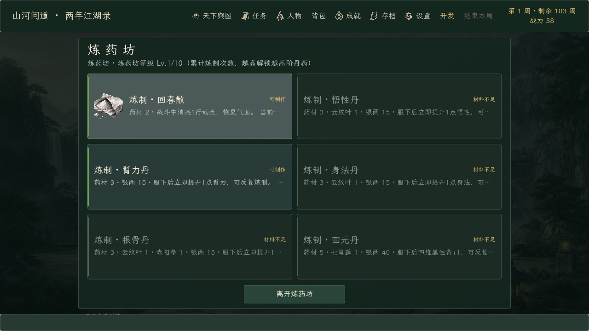
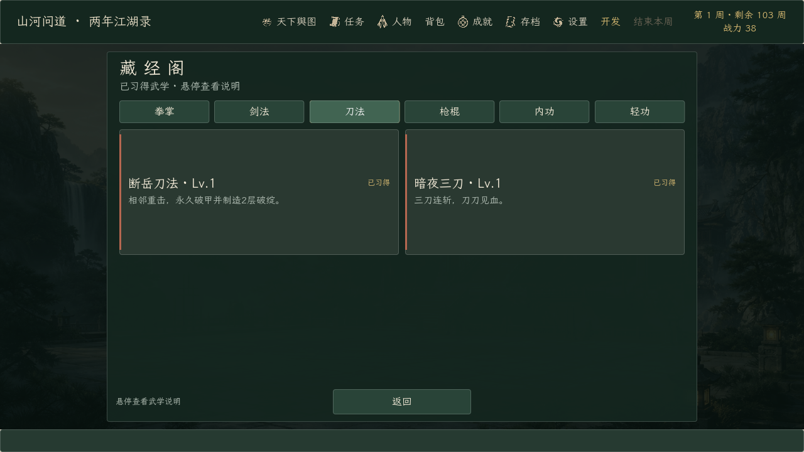
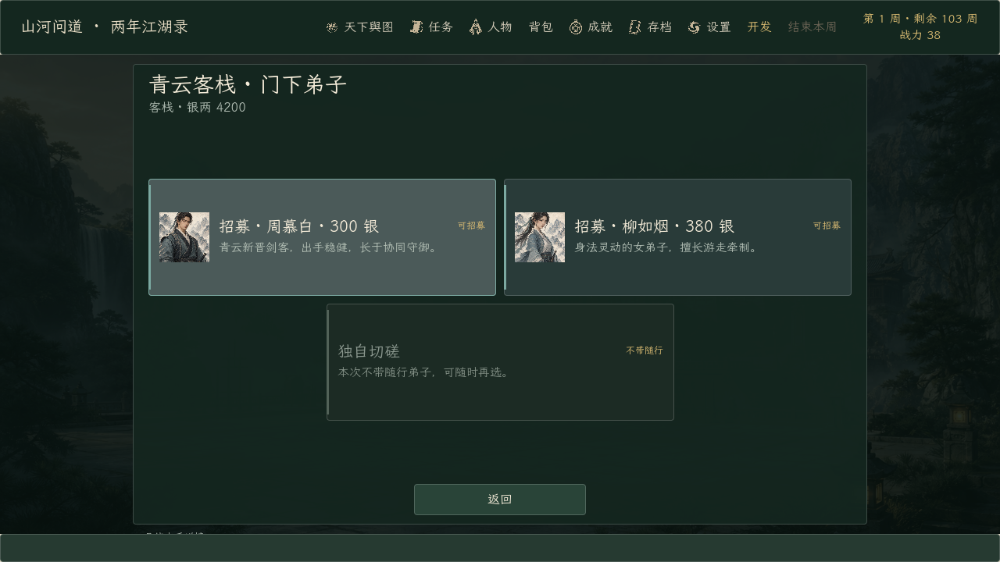
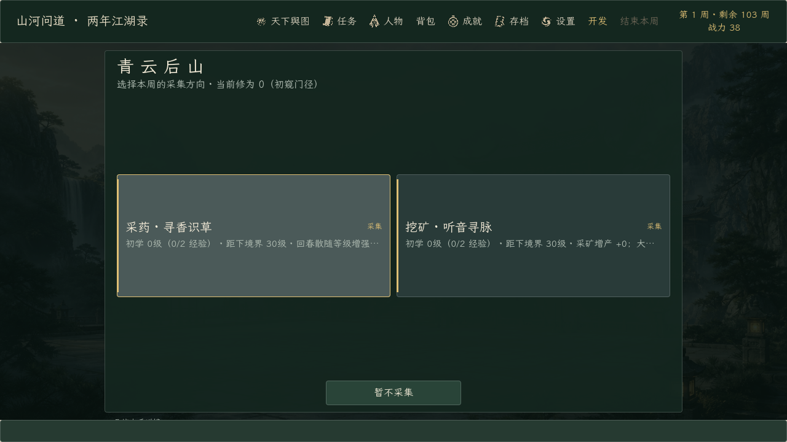
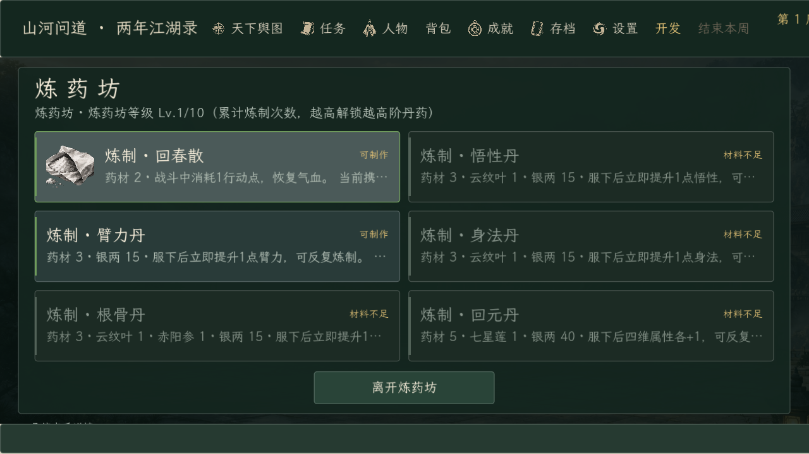

# 《山河问道》完整版 0.174.0 · 青云门建筑卡片布局

日期：2026-10-18。起点提交：`a175fbb`（0.173.0）。

青云门各建筑内部统一为演武场同款的固定卡片网格：

- **正殿**：师父委托以单张卡片显示立绘、委托目标和“可接取”角标，固定“离开正殿”。
- **营造图**：四座建筑以 2×2 卡片显示当前等级、效果与“可升级/材料不足/已满级”，固定“离开营造图”。
- **炼药坊 / 锻造坊**：六张配方卡显示图标、材料消耗、当前状态和“可制作/材料不足”，固定离开按钮。
- **客栈**：弟子卡显示立绘、招募价格、当前随行状态；单张“独自切磋”卡居中。
- **后山**：采药/挖矿两张采集卡显示当前等级、本周专精与收益提示，固定“暂不采集”。
- **藏经阁**：六个分类标签（拳掌/剑法/刀法/枪棍/内功/轻功）切换卡片，每张卡显示武学等级、已装备/已习得状态和说明；旧版右侧滚动列表已移除。

交互和布局规则：

- 标题、分类标签、卡片区和返回按钮位置固定；长说明进入 tooltip，状态进入右上角角标。
- 超过 6 张卡时按页切换，不创建 ScrollContainer；青云门当前所有建筑内容都不需要滚动条。
- 洛阳西市等仍使用 ChoiceView 长列表的界面改用 `DragScrollContainer`：按住鼠标左键拖动即可滚动，拖拽不会误触指针下的按钮；不移动的普通点击仍然正常触发。
- 卡片按钮保留完整标题+说明文本，兼容现有测试和键盘/鼠标焦点。

| 验证 | 结果 | 内容 |
| --- | ---: | --- |
| 隔离导入 | 1 / 1 | 独立工程名与 APPDATA，第二次导入后零诊断错误 |
| 定向回归 | 19 / 19 | 新增建筑布局与拖拽滚动测试；含藏经阁、炼药/锻造、客栈、正殿、营造图、后山、战斗与训练键盘输入 |
| 基线回归 | 25 / 25 | 任务、存档、完整旅程、门派、战斗退出等 |
| 实际渲染 | 3 / 3 | 演武场、建筑布局、切磋预览；建筑布局 639 项检查（含截图 655 项），0 失败 |
| 正式导出 | 2 / 2 | 导入 + Windows Desktop 完整版导出 |
| 正式 EXE | 5 / 5 | 完整版标记、制作名单、Steam 数据、训练流程、暂停流程 |
| 正式 PCK | 4 / 4 | 演武场布局/渲染 + 建筑布局/渲染，共 0 失败 |

定向与基线共有 7 项重叠，合计覆盖 37 个不同测试脚本、44 次执行，全部通过。最终建筑视图哈希 `42C9F2…` 贯穿测试、导出、EXE 与 PCK 检查。详细结果见 [verification-summary.json](verification-summary.json)。

130% 缩放下顶部全局状态仍会被裁切，这是 0.171.0 已记录的问题；建筑面板、卡片和返回按钮均完整位于可见区域。所有输入均由自动化完成，未声称真人完整试玩。

正式 EXE 为 `0.174.0.0`，109,268,480 字节，SHA-256 `1BAEAB…EC12`；PCK 59,375,564 字节，SHA-256 `4F2CD8…AE7F`。完整哈希见 [artifact-manifest.json](artifact-manifest.json)。Demo 预设仍为 0.122.0.0，Demo EXE/PCK 哈希与改动前一致；本次只导出并验证完整版。
