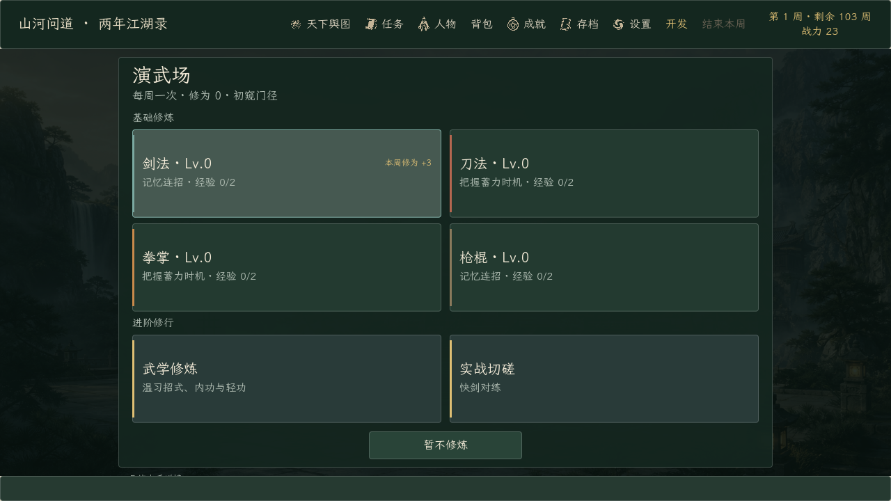

# 《山河问道》完整版 0.173.0 · 兵器专精按类别强化

日期：2026-10-18。起点提交：`7ab6255`（0.172.0）。

演武场四项兵器专精不再只强化某一门招牌武学，而是按武学类别生效：

| 专精 | 影响范围 | 当前招式 |
| --- | --- | --- |
| 剑法 | 全部剑法 | 流云剑法 |
| 刀法 | 全部刀法，并保留普通攻击加成 | 断岳刀法、暗夜三刀 |
| 拳掌 | 全部拳掌 | 裂石拳 |
| 枪棍 | 全部枪棍 | 裂甲枪 |

- 每 2 级增加 1 点伤害：6 级 +3，100 级 +50。
- 暗夜三刀为三连击，每一击都获得专精加成；100 级时每击 +50，合计 +150。
- 单门武学的自身等级（秘籍阁升级/武学修炼）仍只作用于该门武学，并与类别专精加成叠加。
- 预览与实际伤害共用 `WuxueRules.move_category_damage_bonus()`，以后新增同类武学会自动继承对应专精加成。
- 刀法原有的普通攻击加成保留，并在提示中明确写作“全部刀法威力与普攻”。
- 存档结构未变；已有专精等级会按新规则直接作用于所有同类武学。

| 验证 | 结果 | 内容 |
| --- | ---: | --- |
| 隔离导入 | 1 / 1 | 独立工程名与 APPDATA，零诊断错误 |
| 定向回归 | 14 / 14 | 纳入并补强 `test_battle_engine`：五门招式类别加成、跨类别隔离、刀法普攻与暗夜三刀逐击加成 |
| 基线回归 | 25 / 25 | 任务、存档、完整旅程、门派、战斗退出、训练键盘输入等 |
| 实际渲染 | 2 / 2 | 100%/115%/130% 与 1000×720、1280×600；37 张截图，含截图时 2028 项布局检查 |
| 正式导出 | 2 / 2 | 导入 + Windows Desktop 完整版导出 |
| 正式 EXE | 5 / 5 | 完整版标记、制作名单、Steam 数据、训练流程、暂停流程 |
| 正式 PCK | 2 / 2 | 真实包布局检查 1991 项、含截图 2028 项，均 0 失败 |

定向与基线共有 6 项重叠，合计覆盖 33 个不同测试脚本、39 次执行，全部通过。最终 `battle_engine.gd` 哈希 `D7FF5F…` 贯穿测试、导出、EXE 和 PCK 检查。详细逐项结果见 [verification-summary.json](verification-summary.json)。

本次没有改动演武场布局，截图用于确认 0.173.0 构建和原有界面仍然正常；角色页的专精说明文字已同步为“提升全部剑法/刀法/拳掌/枪棍威力”。剑法、拳掌、枪棍目前各只有一门武学，类别机制由刀法的两门武学（断岳刀法、暗夜三刀）和统一的类别映射共同验证。所有输入均由自动化完成，未声称真人完整试玩。

正式 EXE 为 `0.173.0.0`，109,268,480 字节，SHA-256 `7B3EC2…8C6C`；PCK 59,357,512 字节，SHA-256 `AA102F…7A9E`。完整哈希见 [artifact-manifest.json](artifact-manifest.json)。Demo 预设仍为 0.122.0.0，Demo EXE/PCK 哈希与改动前一致；本次只导出并验证完整版。
