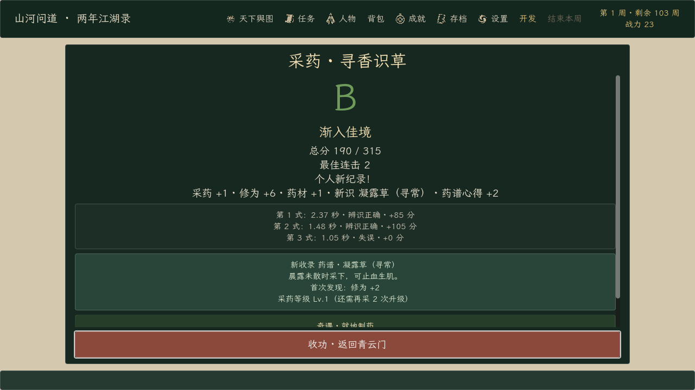
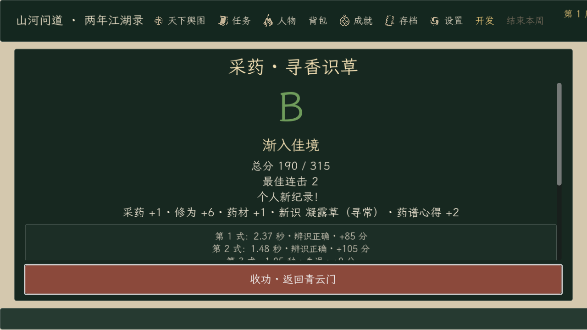

# 《山河问道》0.174.1 · 修炼结算页退出修复

日期：2026-10-18。起点提交：`d2d68b3`（0.174.0）。

## 问题

修炼结束后的结算页把标题、评价、分数、逐式明细、药谱/矿谱收录、奇遇和「收功」按钮全部塞进固定 `940×570` 的面板。内容增多后「收功」被挤到面板下方，屏幕上看不到，玩家只能停在结算页。130% UI 缩放下固定面板还会横向超出可见区域。

## 修复

- 结算面板改为按实际可见内容区计算宽度和高度，不再使用固定 940×570。
- 标题和「收功 · 返回青云门」固定在面板上下；中间的长结算内容放入独立 `DragScrollContainer`，可滚轮滚动或按住鼠标左键拖动。
- 「收功」始终位于滚动区之外，1.0 与 1.3 UI 缩放都完整可见；进入结算时自动获得键盘/手柄焦点。
- 结算内容本身、评分和奖励逻辑不变；存档结构未变。

## 验证

| 验证 | 结果 | 内容 |
| --- | ---: | --- |
| 隔离导入 | 1 / 1 | 独立工程与 APPDATA，零诊断错误 |
| 定向回归 | 20 / 20 | 新增结算页布局测试：1.0/1.3 缩放、固定收功按钮、长内容可滚动、点击收功回到门派 |
| 基线回归 | 25 / 25 | 任务、存档、完整旅程、门派、战斗退出等 |
| 实际渲染 | 4 / 4 | 结算页、演武场、建筑布局、切磋预览；结算页 100%/130% 截图均确认收功可见 |
| 正式导出 | 2 / 2 | 导入 + Windows Desktop 完整版导出 |
| 正式 EXE | 5 / 5 | 完整版标记、制作名单、Steam 数据、训练流程、暂停流程 |
| 正式 PCK | 6 / 6 | 演武场布局/渲染、建筑布局/渲染、结算页布局/渲染 |

定向与基线共有 7 项重叠，合计覆盖 38 个不同测试脚本、45 次执行，全部通过。最终 `training_minigame_view.gd` 哈希 `523253…` 贯穿测试、导出、EXE 与 PCK 检查。详细结果见 [verification-summary.json](verification-summary.json)。

130% 缩放下顶部全局状态栏仍会被裁切，这是 0.171.0 已记录的问题；结算面板、收功按钮和滚动区都完整位于可见区域。所有输入均由自动化完成，未声称真人完整试玩。

正式 EXE 为 `0.174.1.0`，109,268,480 字节，SHA-256 `AFF21D…BAC4`；PCK 59,376,316 字节，SHA-256 `979ADD…ED31`。完整哈希见 [artifact-manifest.json](artifact-manifest.json)。Demo 预设仍为 0.122.0.0，Demo EXE/PCK 哈希未变；本次只导出并验证完整版。
