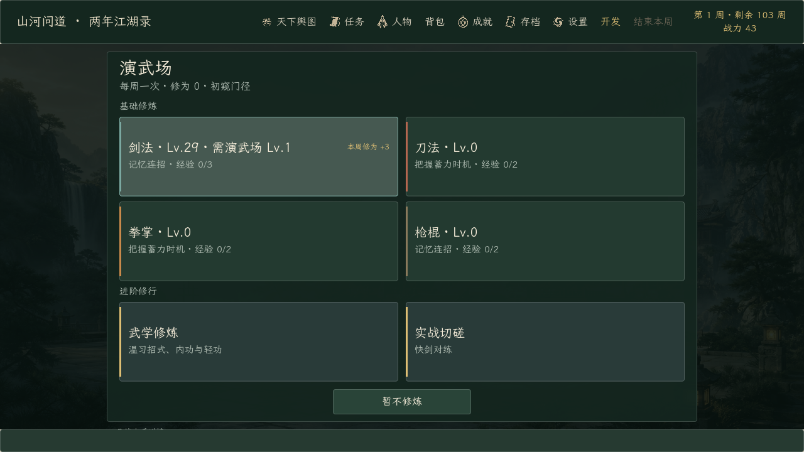
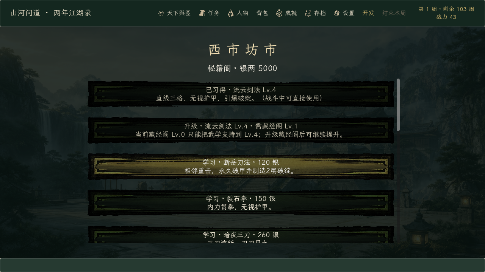
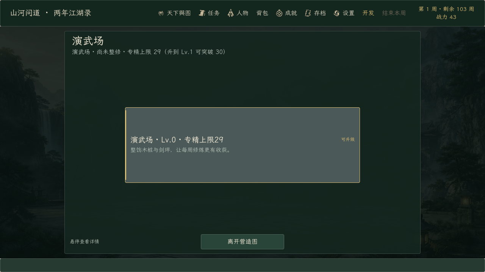

# 《山河问道》0.176.0 · 建筑门槛

日期：2026-10-19。起点提交：`7288d6c`（0.175.0）。

## 目标

让门派建设不只是数值加成，而是**成长上限**：演武场决定四项武学专精能突破到哪一档，藏经阁决定武学能升到几级。玩家必须先投入建设，才能把专精推到 30/60/100、把武学推到 6/8/10 级。

## 改动

- `training_minigame_rules.gd`：新增 `specialty_cap()` / `specialty_capped()`；演武场 Lv.0/1/2/3 对应专精上限 29/59/99/100；`train_specialty()` 在达到上限时最多保留一级经验，升完建筑后立即兑现；专精卡片标题与说明显示“需演武场 Lv.N”。
- `wuxue_rules.gd`：新增 `mastery_cap()`；藏经阁 Lv.0/1/2/3 对应武学上限 4/6/8/10；`_train()` 与 `upgrade_move/internal/lightness()` 都执行上限；秘籍阁的升级行在锁定时显示“需藏经阁 Lv.N”并禁用；武学修炼卡片标题显示“需藏经阁 Lv.N”。
- `sect_building_rules.gd`：新增 `unlock_text()` / `unlock_short()`；营造图卡片标题直接显示“专精上限29 / 武学上限4”，选中建筑页的副标题显示完整解锁说明与下一级预览。
- `game_state.gd`：`complete_training()` 把 `specialty_capped/specialty_cap` 写进结算结果。
- `main.gd`：修炼/武学卡片标题、徽章与建筑页副标题接入上限提示；新增 `--verify-building-gates` 发布自检。
- **存档结构未变**：`SAVE_VERSION` 保持 13；旧档已达到的等级保留（祖父条款），只限制继续提升，因此不需要迁移。
- 版本：主菜单、`godot/README.md`、`export_presets.cfg`（仅 Windows Desktop）同步到 0.176.0。

## 验证

| 验证 | 结果 | 内容 |
| --- | ---: | --- |
| 新增门槛单测 | 1 / 1 | 上限映射、封顶停级、经验保留、祖父条款、解锁后突破、秘籍阁禁用行、建筑卡解锁文案 |
| 单元/视图套件 | 65 / 65 | 全部非隔离脚本；13 个隔离流程脚本另行执行 |
| 隔离门派旅程 | 1168 checks / 0 failures | 建设、采集、锻造、秘籍折扣、期限与结局全流程 |
| 隔离全旅程 | 通过 | 三难度 × 装备/裸装 × 3 种子的完整主线 |
| 正式 EXE 自检 | 8 / 8 | 建筑门槛、门派职守、完整版标记、制作名单、Steam 数据、训练、锻造、暂停 |
| 实际渲染 | 3 / 3 | 专精上限、秘籍阁锁定行、营造图解锁 |

## 截图

## 产物

- `build/windows/ShanheWendao.exe`：`0.176.0.0`，109,268,480 字节，SHA-256 `32993433…1A56B5`。
- `build/windows/ShanheWendao.pck`：59,389,616 字节，SHA-256 `928AC144…5C09EB0`。
- Demo 预设与 `build/windows-demo/ShanheWendaoDemo.exe` 未改动（仍为 0.122.0.0，2026-09-20）。
