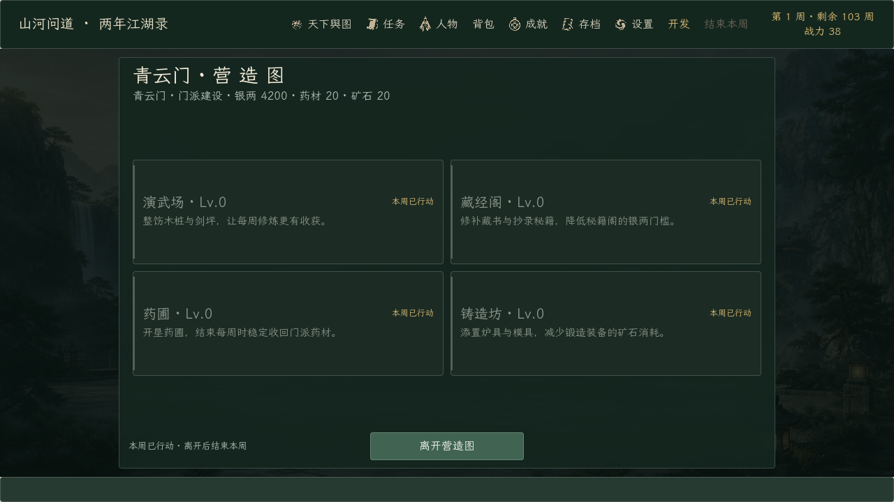
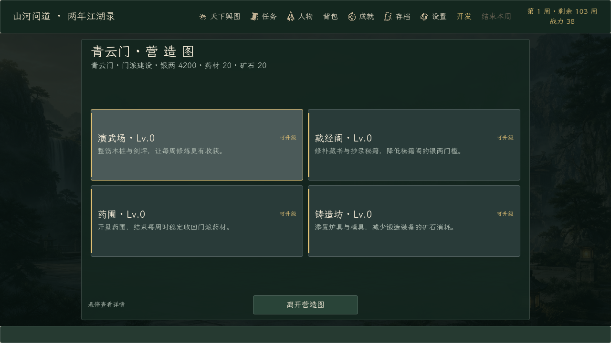

# 《山河问道》0.174.2 · 门派建设“永远材料不足”修复

日期：2026-10-19。起点提交：`f08d522`（0.174.1）。

## 问题

门派建设每次升级都会消耗本周行动。营造图在行动已经用掉后仍然可以打开，但所有卡片都只显示「材料不足」：

- 存档实际有 **药材 5、矿石 6、银两 10,036**，足够支付 Lv.0→1 的 300 银、1 药材、2 矿石；
- 真正原因是 `acted_this_week = true`，要等本周结束；
- 旧卡片把“行动已用”也笼统写成“材料不足”，看起来像永远建不了。

## 修复

- 新增 `SectBuildingRules.upgrade_block_reason()`，按顺序区分：已满级、两年期限已到、本周已行动、银两不足、药材不足、矿石不足。
- 营造图卡片角标改为对应状态：「本周已行动」「银两不足」「材料不足」「期限已到」「已满级」。
- 卡片 tooltip 和底部提示明确写“本周已行动 · 离开后结束本周”。
- 升级规则、材料成本、每周行动限制均未改动；存档结构未变。

## 验证

| 验证 | 结果 | 内容 |
| --- | ---: | --- |
| 隔离导入 | 1 / 1 | 独立工程与 APPDATA，零诊断错误 |
| 定向回归 | 20 / 20 | 含建筑卡片状态、结算页、拖拽滚动、藏经阁、炼药/锻造、客栈 |
| 基线回归 | 25 / 25 | 任务、存档、完整旅程、门派、战斗退出等 |
| 实际渲染 | 4 / 4 | 营造图“本周已行动/可升级”两种状态、结算页、演武场、切磋 |
| 正式导出 | 2 / 2 | 导入 + Windows Desktop 完整版导出 |
| 正式 EXE | 5 / 5 | 完整版标记、制作名单、Steam 数据、训练流程、暂停流程 |
| 正式 PCK | 6 / 6 | 演武场、建筑、结算页的布局与渲染 |

定向与基线共有 7 项重叠，合计覆盖 38 个不同测试脚本、45 次执行，全部通过。新增断言同时覆盖：足量材料但本周已行动时必须是「本周已行动」；结束本周后恢复「可升级」；银两/药材/矿石不足、期限和大成分别显示正确原因。详细结果见 [verification-summary.json](verification-summary.json)。

正式 EXE 为 `0.174.2.0`，109,268,480 字节，SHA-256 `AA660D…0AB8`；PCK 59,377,660 字节，SHA-256 `B68975…FC80`。完整哈希见 [artifact-manifest.json](artifact-manifest.json)。Demo 预设仍为 0.122.0.0，Demo EXE/PCK 哈希未变；本次只导出并验证完整版。
