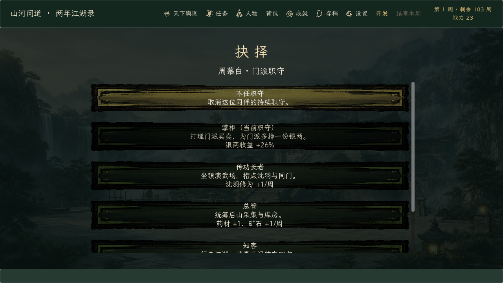
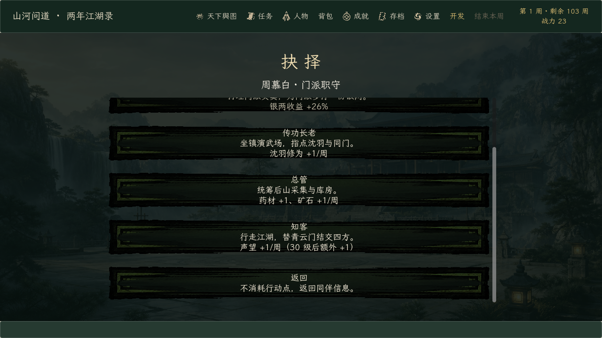

# 《山河问道》0.175.0 · 门派职守

日期：2026-10-19。起点提交：`6131bc1`（0.174.2）。

## 目标

把 0.115.0 的“同伴分派任务”升级为有身份的**门派职守**，让林清霜与两名可招募弟子都能按各自属性参与门派经营，同时不改变“沈羽每周 1 次行动”的节奏：

- 掌柜：赚钱收益 +25%～60%，随悟性成长；
- 传功长老：沈羽每周额外获得 1～4 点修为，随悟性成长；
- 总管：采集额外带回 1～3 份药材与矿石，随臂力成长；
- 知客：新增“游历”职守，每周带回 1 点声望，30 级后额外 +1。

## 改动

- 新增 `scripts/progression/sect_post_rules.gd`：职位表、收益预测、结算与日志文案；纯规则、零依赖（只引用 `GrowthRules`）。
- `weekly_task_rules.gd`：新增 `envoy` 任务；`resolve_companion()` 接受同伴属性快照并叠加岗位收益；`options_companion()` 改为职守标题 + 预测收益。
- `autoload/game_state.gd`：`end_week()` 为每名同伴构造属性快照（基础目录 + 成长值），结算岗位收益并写入日志；职守仍复用 `companion_tasks` 原 id。
- `main.gd`：同伴面板改为“门派职守”，显示当前职守与每周预测；按钮改为“调整职守”；新增 `--verify-sect-post-flow` 发布自检。
- 存档结构未变：`SAVE_VERSION` 保持 13；旧档的 `train/earn/gather` 直接按新职守生效，无需迁移。
- 版本：主菜单、`godot/README.md`、`export_presets.cfg`（仅 Windows Desktop）同步到 0.175.0。

## 验证

| 验证 | 结果 | 内容 |
| --- | ---: | --- |
| 新增规则单测 | 2 / 2 | `test_sect_post_rules` 覆盖四岗位预测/结算/上限；`test_weekly_task_rules` 覆盖职守文案与加成 |
| 单元/视图套件 | 64 / 64 | 全部非隔离脚本；13 个隔离流程脚本另行执行 |
| 隔离流程 | 2 / 2 | `test_management_flow`（商店/招募/切磋）与 `test_full_journey`（多难度全旅程）在 `ShanheWendao-iteration-tests` 副本中通过 |
| 正式 EXE 自检 | 7 / 7 | 完整版标记、制作名单、Steam 数据、训练流程、锻造流程、暂停流程、门派职守流程 |
| 实际渲染 | 3 / 3 | 门派职守面板、职守选择（顶部/底部） |

合计：64 个单元/视图脚本 + 2 个隔离流程 + 7 项正式 EXE 自检，全部通过；隔离套件中 13 个需要独立工程/存档的脚本单独执行。

新增断言覆盖：掌柜 18 两基础收益按 26% 加 5 两；总管在 roll 5 时从 2/2 变为 3/3；传功给沈羽 +1 修为；知客 30 级后额外 +1 声望；无效职守被拒绝。

## 截图

## 产物

- `build/windows/ShanheWendao.exe`：`0.175.0.0`，109,268,480 字节，SHA-256 `EE04D719…C3F4CA`。
- `build/windows/ShanheWendao.pck`：59,384,944 字节，SHA-256 `1D04E74E…1A8A3`。
- Demo 预设与 `build/windows-demo/ShanheWendaoDemo.exe` 未改动（仍为 0.122.0.0，2026-09-20）。
